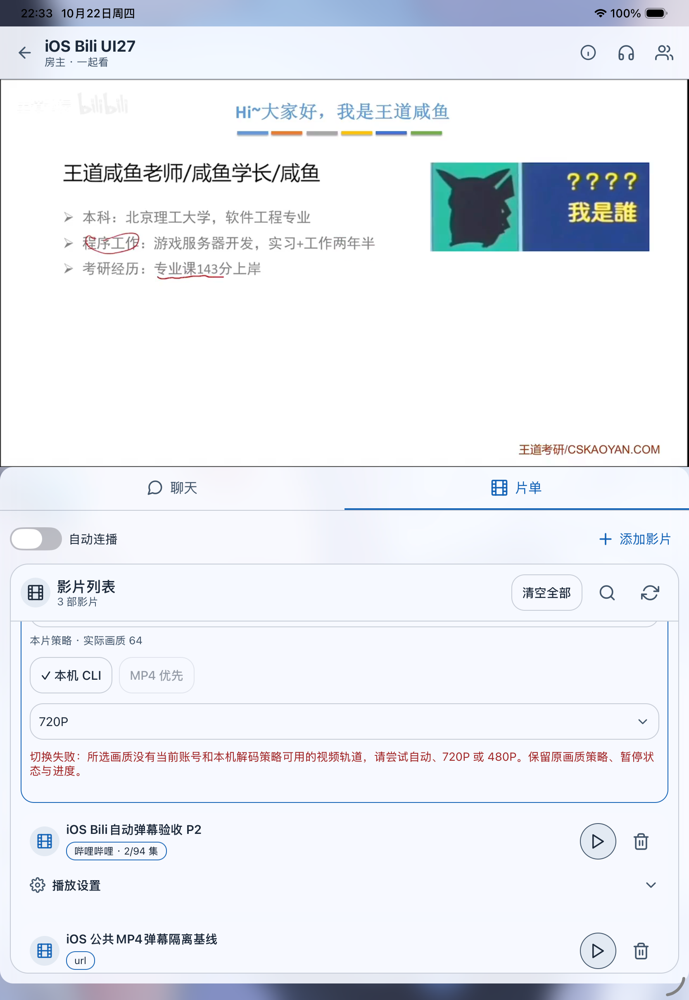
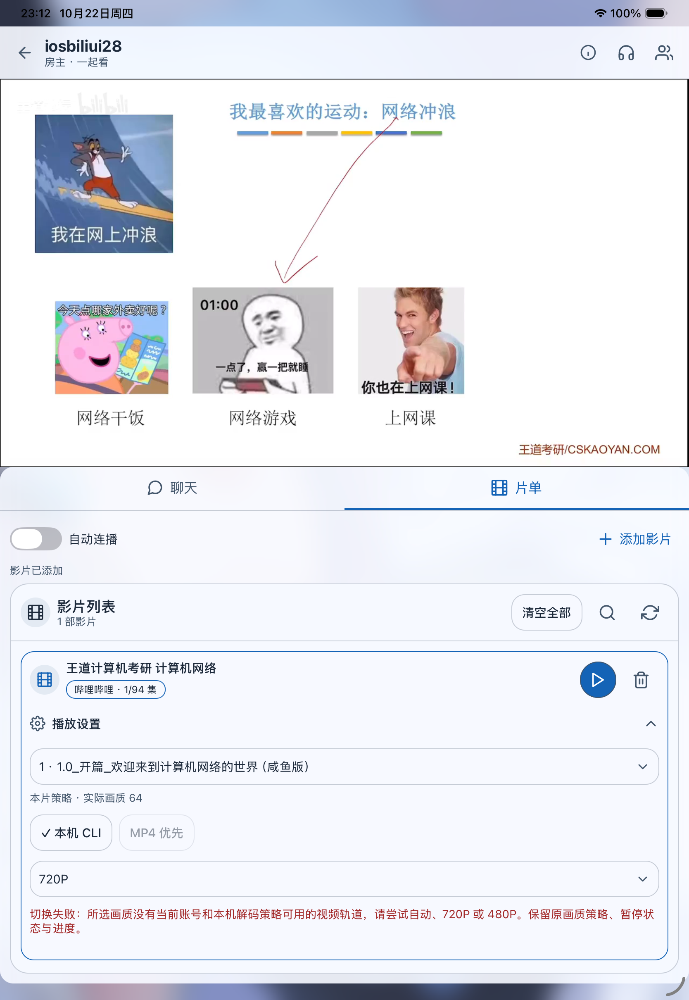

# iOS 本机 B站 CLI 登录与画质验收

日期：2026-10-22。环境：iPad Pro 11-inch (M5)，iOS 26.5 Simulator，标准 adhoc 签名 Debug18。用户主动扫码授权后进行原生 Go 解析和真实 UI 验收。证据仅保存布尔状态与画质元数据，不含账号名、Cookie、媒体 URL 或测试服务器凭据。

- 原生服务 ready=true、loggedIn=true；冷启动新进程后无需再次扫码，Keychain 登录恢复成功。未签名 Simulator Debug17 无法保存 Keychain，改用标准模拟器签名后成功；这不是第三代 iPad 真机根因的证明。
- 自动、360P、480P、720P 的真实原生 resolve 均成功，返回 AVC DASH 视频和音轨。
- UI 实际影片播放进度由零前进到 0:29 / 8:38；480P 切换显示实际 QN32，720P 显示 QN64。
- UI 选择1080P显示设备/账号没有可用视频轨道，保留720P；未误报“请登录CLI”。1080P、高码率、60帧、4K原生解析同样返回明确的轨道限制。
- 旧房间服务端内存片单丢失时，仅当前房主重新 register-host 一次并重试播放，观众不抢占房主；恢复后真实影片可播。
- npm run check：419/419，通过补丁检查、lint、TypeScript与测试。

Simulator使用软件AVC720P30策略；Debug18时实体设备保留既有保守策略，后续已按用户授权在build28更新为真实硬件关键帧探测。本次没有在用户的 iPad Pro 第三代真机上验证1080P或更高档位，不以模拟器通过代替真机解码、音画同步、长时播放验收。

## build28 / Debug19 追加验收

最新421 / 421自动检查及20个原生AVC / HEVC横竖尺寸关键帧夹具通过。新进程恢复已扫码Keychain登录，自动 / 360P / 480P / 720P实际解析成功；真实UI显示480P的QN32及720P的QN64，进度1:02→2:34，画面正常。选择1080P后准确显示设备 / 账号轨道限制，保留720P及播放进度，没有再次要求登录CLI。结构化记录见[bili-cli-build28](bili-cli-build28-2026-10-22.json)。

真机逐codec及精确横竖尺寸探测硬件会话、格式接受与实际关键帧解码，通过后开放AVC High / HEVC Main 8bit420 SDR，最高4K30；60fps / AV1 / HDR / 杜比未开放。Simulator继续AVC720P30 / 480P30。该探测不等于高码率实时持续播放或音画同步；第三代iPad Pro真机仍待验证。

